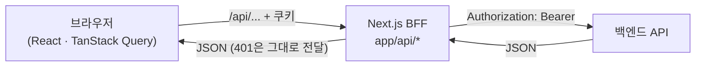

<div align="center">

# 🧱 BrickByBrick

**오늘 쌓은 하나의 할 일, 내일의 단단한 포트폴리오.**

프로젝트를 세우고, 할 일을 하나씩 쌓고, 배운 것을 기록으로 남기는 할 일·포트폴리오 관리 서비스

[🔗 서비스 바로가기](https://todo-sprint-4cus.vercel.app)

<!-- 대표 스크린샷을 넣어 주세요 -->
<!--  -->

</div>

<br />

## 📌 목차

- [프로젝트 소개](#-프로젝트-소개)
- [주요 기능](#-주요-기능)
- [기술 스택](#-기술-스택)
- [아키텍처](#-아키텍처)
- [폴더 구조](#-폴더-구조)
- [시작하기](#-시작하기)
- [협업 방식](#-협업-방식)
- [팀원](#-팀원)

<br />

## 🧱 프로젝트 소개

BrickByBrick은 **할 일 관리 기능을 그대로 살려 포트폴리오를 만들어 가는** 서비스입니다.

| 할 일 앱에서 | BrickByBrick에서                               |
| ------------ | ---------------------------------------------- |
| 목표         | **프로젝트**: 포트폴리오에 들어갈 작업 하나    |
| 할 일        | **브릭**: 프로젝트를 만드는 세부 단계          |
| 노트         | **작업 기록**: 무엇을 배웠고 어떻게 해결했는지 |
| 찜한 할 일   | **대표 기록**: 포트폴리오에 꼭 보여 줄 작업    |

<br />

## ✨ 주요 기능

| 화면                   | 경로                                                     | 기능                                                   |
| ---------------------- | -------------------------------------------------------- | ------------------------------------------------------ |
| 랜딩                   | `/`                                                      | 서비스 소개, 스크롤 애니메이션                         |
| 로그인·회원가입        | `/login`, `/signup`                                      | 이메일 로그인, 구글·카카오 소셜 로그인                 |
| 작업대 (대시보드)      | `/dashboard`                                             | 최근 할 일, 전체 진행률, 프로젝트별 할 일              |
| 프로젝트 상세          | `/goals/[goalId]`                                        | 프로젝트 진행률, TO DO / DONE 목록, 작업 기록 바로가기 |
| 브릭 로그 (모든 할 일) | `/todos`                                                 | 상태별 탭, 할 일 생성·수정·삭제, 할 일 상세            |
| 빌드 캘린더            | `/calendar`                                              | 마감일 기준 월간 캘린더, 프로젝트 필터                 |
| 작업 기록              | `/notes`                                                 | 프로젝트별 작업 기록 목록, 검색·정렬, 상세 보기        |
| 작업 기록 작성·수정    | `/notes/write?todoId=`, `/notes/edit?noteId=`            | 리치 텍스트 에디터(Tiptap), 링크 첨부                  |
| 대표 기록              | `/favorites`                                             | 찜한 할 일 모아보기, 프로젝트 필터                     |
| 소통 게시판            | `/posts`                                                 | 베스트 글, 검색·정렬, 무한 스크롤                      |
| 게시글 작성·수정·상세  | `/posts/write`, `/posts/edit?postId=`, `/posts/[postId]` | 이미지 첨부, 댓글, 댓글 좋아요                         |
| 내 정보                | `/mypage`                                                | 프로필 이미지·이름 수정, 비밀번호 변경                 |
| 설정 팝업              | 사이드바 > 설정                                          | 한국어 / English 전환, 라이트 / 다크 모드              |

<br />

## 🛠 기술 스택

| 분류            | 사용 기술                                                 |
| --------------- | --------------------------------------------------------- |
| 프레임워크      | Next.js 16 (App Router), React 19, TypeScript             |
| 스타일          | Tailwind CSS v4, class-variance-authority, tailwind-merge |
| UI 컴포넌트     | Radix UI, Material Symbols, Sonner (토스트)               |
| 서버 상태       | TanStack Query v5                                         |
| 클라이언트 상태 | Zustand                                                   |
| 폼              | React Hook Form, Zod                                      |
| 에디터          | Tiptap                                                    |
| 다국어·테마     | next-intl, next-themes                                    |
| 애니메이션      | GSAP                                                      |
| HTTP            | Axios (BFF → 백엔드)                                      |
| 테스트          | Vitest, Testing Library, jsdom                            |
| 컴포넌트 문서   | Storybook                                                 |
| 코드 품질       | ESLint, Prettier, Husky, lint-staged                      |
| CI·리뷰·배포    | GitHub Actions, CodeRabbit, Vercel                        |

<br />

## 🏗 아키텍처

### BFF (Backend For Frontend)

브라우저는 백엔드에 직접 요청하지 않고, Next.js의 Route Handler(`app/api/*`)를 거칩니다.



- **토큰을 브라우저 JS에 노출하지 않습니다.** access·refresh token은 httpOnly 쿠키에 두고, BFF가 꺼내서 백엔드 요청에 붙입니다.
- `app/api/*`의 대부분은 `forward` 한 줄로 요청을 그대로 전달합니다. 허용할 경로와 메서드는 route 파일의 존재와 export로 정합니다.
- 401을 받으면 클라이언트가 refresh 후 원래 요청을 다시 보냅니다.
- `proxy.ts`가 로그인 여부(refresh token 쿠키)로 페이지 접근을 1차로 나누고, 실제 보호는 API의 401이 맡습니다.

### 다국어와 테마

- 언어는 주소에 들어갑니다: `/ko/dashboard`, `/en/dashboard`. 문구는 `messages/ko.json`, `messages/en.json`에서 관리합니다.
- 테마는 next-themes가 `<html data-theme="light|dark">`를 붙이고, `styles/theme.css`의 테마 변수(`bg-white-section`, `text-foreground` 등)가 이를 따릅니다. 처음에는 OS 설정을 따릅니다.

<br />

## 📁 폴더 구조

```
├── app
│   ├── [locale]                  # 언어별 페이지 (ko, en)
│   │   ├── (routes)
│   │   │   ├── (auth)            # 로그인, 회원가입
│   │   │   └── (dashboard)       # 로그인 후 화면 (GNB 포함 레이아웃)
│   │   ├── layout.tsx            # 최상위 레이아웃 (Provider 연결)
│   │   └── page.tsx              # 랜딩
│   └── api                       # BFF Route Handler
├── components                    # 화면별 컴포넌트 (auth, todo, note, post, setting …)
│   └── ui                        # 공용 UI (Button, Modal, TextField, 에디터 …)
├── hooks                         # 커스텀 훅
├── i18n                          # next-intl 라우팅·내비게이션 설정
├── lib
│   ├── api                       # 클라이언트에서 BFF를 부르는 함수
│   └── server                    # 서버 전용 코드 (백엔드 호출, 세션)
├── messages                      # 번역 문구 (ko.json, en.json)
├── providers                     # QueryProvider, ThemeProvider
├── queries                       # TanStack Query queryOptions·mutationOptions, query key
├── styles                        # 디자인 토큰, 테마 변수
├── test                          # 테스트 공용 Provider·모킹 도구
├── types/api                     # API 요청·응답 타입
└── proxy.ts                      # 언어 라우팅 + 로그인 여부에 따른 접근 제어
```

<br />

## 🚀 시작하기

### 요구 사항

- Node.js 22 (`.nvmrc`)
- pnpm 10.34.5 (`package.json`의 `packageManager`)

### 설치와 실행

```bash
nvm install
nvm use
corepack enable
pnpm install
```

프로젝트 루트에 `.env.local`을 만들고 백엔드 주소를 넣어 주세요.

```bash
BACKEND_API_URL=<백엔드 API 주소>
```

```bash
pnpm dev
```

[http://localhost:3000](http://localhost:3000)에서 확인할 수 있습니다.

### 스크립트

| 명령                        | 설명                                       |
| --------------------------- | ------------------------------------------ |
| `pnpm dev`                  | 개발 서버 실행                             |
| `pnpm build` / `pnpm start` | 프로덕션 빌드 / 실행                       |
| `pnpm lint`                 | ESLint 검사                                |
| `pnpm typecheck`            | Next.js 타입 생성 후 TypeScript 검사       |
| `pnpm test`                 | Vitest (watch 모드)                        |
| `pnpm test:run`             | Vitest 한 번 실행                          |
| `pnpm check`                | 린트 → 타입 검사 → 테스트 (CI와 같은 검사) |
| `pnpm storybook`            | Storybook 실행 (http://localhost:6006)     |
| `pnpm format`               | Prettier로 전체 정리                       |

<br />

## 🤝 협업 방식

### 브랜치

`main`에서 작업 브랜치를 만들고, PR로 `main`에 합칩니다.

| 접두어     | 용도      | 예시                             |
| ---------- | --------- | -------------------------------- |
| `feature/` | 새 기능   | `feature/setting-modal`          |
| `fix/`     | 버그 수정 | `fix/gnb-tests`                  |
| `chore/`   | 설정·도구 | `chore/add-ci-workflow`          |
| `perf/`    | 성능 개선 | `perf/dashboard-initial-loading` |

### 커밋 메시지

```
<type>: <한국어 요약>
```

`feat` 기능 · `fix` 버그 · `refactor` 리팩토링 · `style` 스타일 · `test` 테스트 · `chore` 설정 · `ci` CI · `perf` 성능

### PR과 자동 검사

1. `.github/PULL_REQUEST_TEMPLATE.md` 양식으로 작업 내용과 JIRA 티켓을 적습니다.
2. 커밋할 때 **Husky + lint-staged**가 바뀐 파일에 ESLint·Prettier를 자동 적용합니다.
3. PR을 올리면 다음이 자동으로 실행됩니다.

- **GitHub Actions CI**: 의존성 설치(`--frozen-lockfile`) → 린트 → 타입 검사 → 테스트
- **CodeRabbit**: 한국어 AI 코드 리뷰
- **Vercel**: 미리보기 배포

4. 팀원 리뷰 후 병합합니다.

> PR 올리기 전에 `pnpm check`를 실행하면 CI와 같은 검사를 로컬에서 미리 확인할 수 있습니다.

<br />

## 👥 팀원

| 이름   | GitHub                                       | 담당                                                                                                                                       |
| ------ | -------------------------------------------- | ------------------------------------------------------------------------------------------------------------------------------------------ |
| 최용재 | [@yjc2021](https://github.com/yjc2021)       | 공용 API·BFF와 인증,소통 게시판 페이지,빌드 캘린더 페이지,내 정보 페이지                                                                   |
| 이지수 | [@ljisu1107](https://github.com/ljisu1107)   | 작업 기록(노트), 게시글 작성·수정, 설정(다국어·다크모드), CI·CodeRabbit 설정                                                               |
| 현수민 | [@so-om1n](https://github.com/so-om1n)       | 공용 모달·케밥 메뉴,할 일 생성·수정·상세,대표 기록 페이지, 로그인 페이지                                                                   |
| 안상환 | [@ansanghwan](https://github.com/ansanghwan) | Tailwind 설정·디자인 토큰,다크 테마 변수·Pretendard,버튼·GNB·레이아웃,랜딩·작업대 페이지,프로젝트 상세 페이지,리브랜딩 스타일 및 컬러 테마 |
